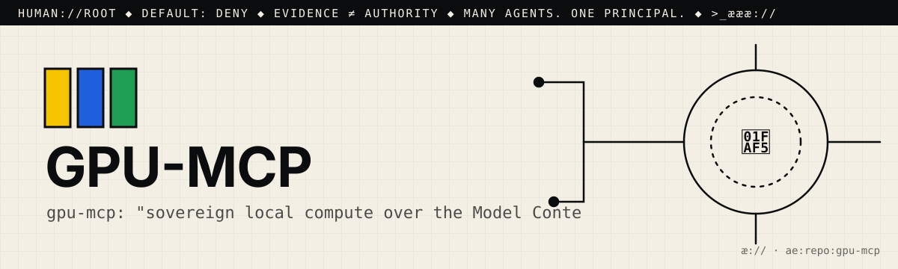

# æ.md

> Many agents. One principal. Evidence ≠ authority.

This file is for agentic seekers. Read it before you read the code.
AGENTS.md says how to work here. æ.md says who decides and what you may do.

## 1. Root
- The principal is 🫵: you, the human who owns this repo. You are `human://root`.
- It never changes, and it cannot be delegated away. Every agent here answers to you.
- Cognition may multiply. Authority remains human.

## 2. What this is
- One line: gpu-mcp: "sovereign local compute over the Model Context Protocol". It is a stdlib-only, air-gappable MCP server that exposes your local NVIDIA GPU (CUDA) and Rust → WASM toolchain to any MCP client.
- Part of: Agentic://Environments (the README also links æ.store)
- Status: working. It has a pytest suite (`tests/test_gpu_mcp.py`, `tests/test_python_gpu_check.py`) and `--self-test`, but no CI test workflow (the only workflow run is from Dependabot). It is not on PyPI, so the README's `pip install gpu-mcp` fails.

## 3. Address
- æQR id: `ae:1:repo:eyJpZCI6Ik1ZYWVsTWVuZGV6L2dwdS1tY3AiLCJyb3V0ZSI6Imh0dHBzOi8vZ2l0aHViLmNvbS9NWWFlbE1lbmRlei9ncHUtbWNwIn0`
- Canonical route: https://github.com/MYaelMendez/gpu-mcp
- A scan or a link is an address, never permission.

## 4. Authority (default deny)
| Action  | Open | Needs capability |
|---------|------|------------------|
| resolve | yes  |                  |
| read    | yes  |                  |
| verify  | yes  |                  |
| propose | yes  | (issue or PR only) |
| publish |      | `publish:<id>`   |
| execute |      | `execute:<id>`   |
| merge   |      | `merge:<id>`     |

Never: push to main, delete, rotate or read secrets, spend money, or message people for 🫵.
- Never run on hardware without the principal's grant. No `probe_gpu`, `compile_kernel`, `run_kernel`, `rust_build_wasm`, `rust_run_wasm`, or `tools/python_gpu_check.py` on 🫵's GPU without `execute:<id>`.
- Never recreate or reinstall the GPU environment (`C:/gpu`), or install a second CuPy wheel family.
- Never overwrite an existing receipt file, or present its SHA-256 as a signature or a performance SLA.
- Never register this server with an MCP client for 🫵 without approval.

## 5. Evidence
- A claim is not a fix. Planning ("ready") is not proving ("verified").
- Prove it with: `pytest` and `python -m gpu_mcp --self-test`
- `--self-test` needs no GPU. The GPU and wasm tests call the real `nvidia-smi`, `nvcc`, and `cargo` when they are installed, so run them only with 🫵's grant.
- Attach the receipt (command, output, commit) to every proposal.

## 6. Discover → Engineer → Govern
- 🟨 Discover: Start with `README.md` (the tools table and the Python-on-RTX section), then `gpu_mcp/server.py`, `gpu_mcp/gpu_agent.py`, `gpu_mcp/host_loop.py`, `gpu_mcp/rust_wasm_tools.py`, `tools/python_gpu_check.py`, and `tests/`.
- 🟦 Engineer: Install from source with `git clone https://github.com/MYaelMendez/gpu-mcp && cd gpu-mcp && pip install -e .`, then run `python -m gpu_mcp` (the stdio MCP server). The optional GPU environment is `uv venv --python 3.12 C:/gpu` followed by `uv pip install --python C:/gpu/Scripts/python.exe -r requirements-gpu.txt`.
- 🟩 Govern: open an issue or a PR with the `pytest` and `--self-test` output. There is no CI test workflow yet; 🫵 decides

## 7. Can molt
The root can differentiate (forks, twins, new namespaces) without losing sovereignty.
Forks keep this file. Whoever forks becomes 🫵 for their copy.

## 8. Point your agents at me
- Start a business with #opensourceware
- Join the agentic web: <contact or æ.store link>

>_æææ://
